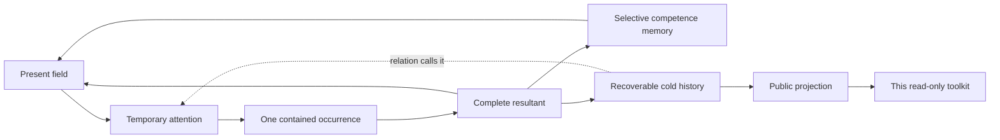

# D-ND Physics Lab

**Explore how a research occurrence changes a field of questions, relations and
competences.** The public companion to the regenerative Physics Lab developed
in MM-DND by Graziano Guiducci.

[Open the current Lab](https://d-nd.com/ai-lab) · [Italiano](README.it.md) ·
[Corpus guide](docs/CORPUS.md) · [Architecture](docs/ARCHITECTURE.md)

The Lab receives a present field, forms temporary attention and records a
complete resultant. A resultant can change what the Lab recognizes in a later
occurrence. Exact history remains reachable while selective memory carries
transformations into the next field. The public workspace exposes these
records, their provenance and recorded contacts.

This checkout provides a working **provider-free public corpus toolkit**,
documentation of the current mechanisms, a synthetic example and the original
physics experiments. The operational researcher, private source archive and
administrative controls stay with MM-DND. The toolkit reads their existing
public projection; it does not start the operational Lab.

## Try an occurrence locally

Python 3.11 or later; no packages, account, API key or Docker required.
From the cloned repository:

```bash
git clone https://github.com/GrazianoGuiducci/dnd-lab-physics.git
cd dnd-lab-physics
python -m physics_lab summary examples/synthetic-corpus.json
python -m physics_lab event examples/synthetic-corpus.json --index 2
python -m physics_lab trace examples/synthetic-corpus.json --index 2
python -m physics_lab report examples/synthetic-corpus.json --output example-report.html
```

Open `example-report.html` in a browser. It works offline, with expandable
occurrences and the complete public record beside each resultant. The example
is synthetic: it demonstrates recorded contact between two occurrences and
contains no Lab measurement or private source material.

## Explore the real public corpus

```bash
python -m physics_lab fetch --output corpus.json
python -m physics_lab verify corpus.json
python -m physics_lab summary corpus.json
python -m physics_lab event corpus.json --index 1
python -m physics_lab report corpus.json --output corpus-report.html
```

`fetch` reads the public HTTPS projection and writes its exact bytes with a
SHA-256 receipt. Every other command above works offline. Existing output
files are preserved; choose a new filename for another capture. Downloads and
generated reports are ignored by Git.

At the **30 October 2026 inspection**, the public projection contained 726
occurrences; its latest recorded occurrence was dated 24 September. This is a
dated snapshot, not a claim of a new run today. Its checksum and the verified
E726 → E018 contact are in [validation](docs/VALIDATION_2026-10-30.md).

## How the regenerative Lab works



An **occurrence** is a finite event. Its **resultant** is retained in the form
in which it occurred. The effect on the field and the effect on memory are
distinct. Cooling releases a relation from present attention while keeping its
history recoverable. No observed difference does not establish that no other
difference is possible.

Recorded contact can be inspected; its presence alone does not prove a causal
improvement or validate a physical theory. Sources, conditions, controls,
invalidators and independent scientific tests determine what a research claim
can support. See [research and evidence](docs/RESEARCH.md).

## MM-DND, this repository and D-ND_LAB

| Surface | What it provides |
| --- | --- |
| **MM-DND** | Current regenerative implementation, private source ownership, occurrence deposits, selective memory and operational controls. |
| **[AI Lab](https://d-nd.com/ai-lab)** | Public workspace, occurrence history, corpus download and THIA-assisted reading. |
| **dnd-lab-physics** | Public explanation, offline corpus tools, examples and the preserved historical physics package. |
| **[D-ND_LAB](https://github.com/GrazianoGuiducci/D-ND_LAB)** | A separate installable domain engine, including its own physics domain and historical bootstrap. |

The regenerative Lab works independently of the older D-ND_LAB orchestrator.
They share genealogy and useful research functions; their cycle contracts,
runtime state and evidence remain distinct. The
[compatibility guide](docs/DND_LAB_COMPATIBILITY.md) explains both routes and
corrects this repository's former installation command.

## Documentation and source map

- [Architecture](docs/ARCHITECTURE.md): field, occurrence, resultant, memory and public projection.
- [Corpus guide](docs/CORPUS.md): all commands, checksums, tracing and comparison.
- [D-ND_LAB compatibility](docs/DND_LAB_COMPATIBILITY.md): domain layout and historical tools.
- [Research and evidence](docs/RESEARCH.md): authorial model, mathematics and exploratory claims.
- [Sources](docs/SOURCES.md): attribution, public contracts and lineage.
- [Privacy and licensing](docs/PRIVACY_AND_LICENSE.md): public input boundary and data rights.
- [Validation](docs/VALIDATION_2026-10-30.md): exercised scope and receipts.
- [Contributing](CONTRIBUTING.md): local checks and useful contribution paths.

`physics_lab/` contains the new public tools. `examples/` and `tests/` are
synthetic. `domain/` and `tools/exp_*.py` preserve the May 2026 package. Their
original claims and agent context are historical artifacts, not the current
Lab's prompt or newly endorsed findings.

## License and citation

Code and documentation retain the existing [MIT license](LICENSE). Downloaded
corpus records keep their source rights; MIT does not relicense them or their
referenced materials. [Details](docs/PRIVACY_AND_LICENSE.md).

Use [CITATION.cff](CITATION.cff) for this toolkit. For the mathematical preprint,
cite **Paper Zero**, revised 28 October 2026:
[10.5281/zenodo.23735742](https://doi.org/10.5281/zenodo.23735742).
Its manuscript-specific CC BY 4.0 license and scientific scope remain separate
from this software and from historical deposits.
